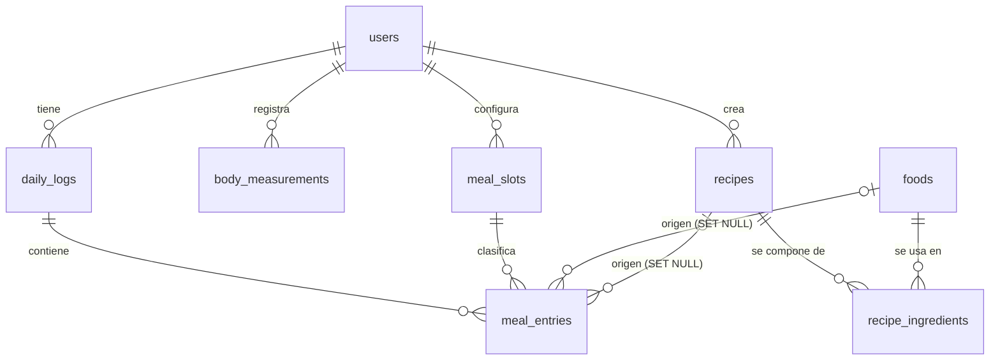

# NutriApp — Arquitectura y punto de partida

App Android de seguimiento nutricional y de composición corporal. **Expo (prebuild) + TypeScript + SQLite local**, offline primero, UI sobria (tarjetas amplias, anillos de progreso, sin gamificación infantil).

Este paquete contiene el **núcleo verificable** (sin Expo ni React Native): motor metabólico, esquema de base de datos y cliente de Open Food Facts. La UI, los repositorios y Health Connect se construyen encima (ver §10).

| Entregable pedido | Dónde está |
|---|---|
| 1. Arquitectura de carpetas | §2 de este documento |
| 2. Esquema relacional | `src/db/migrations/001_init.ts` (fuente) · `docs/schema.sql` (generado) · `src/db/migrate.ts` |
| 3. Motor matemático | `src/domain/nutritionEngine.ts` |
| 4. Cliente Open Food Facts | `src/services/openFoodFacts/*` · `src/domain/food.ts` · `src/config/offClient.ts` |

```bash
npm install             # typescript, tsx, @types/node
npm run typecheck:core  # tsc estricto sobre domain, db, services, config, scripts y tests
npm test                # 80 tests (motor, cliente OFF, SQLite real, configuración)
npm run schema:sql      # regenera docs/schema.sql desde las migraciones
```

---

## 1. Decisiones de stack

| Decisión | Por qué | Cuándo reconsiderarla |
|---|---|---|
| **Expo con prebuild / dev build** (no Expo Go) | Cámara y Health Connect requieren código nativo y config plugins. | — |
| **Expo Router** | Rutas por archivos en `src/app`; estándar en plantillas nuevas. | Si prefieres React Navigation explícito. |
| **`expo-sqlite`** (no WatermelonDB) | Volumen pequeño (cientos de alimentos, miles de entradas). SQL directo permite vistas y agregaciones para gráficos. Sin capa de sincronización que mantener. | Si más adelante necesitas sync multi-dispositivo u observables reactivos sobre listas enormes. |
| **Zustand** | Estado de UI y caché en memoria. **La fuente de verdad es SQLite**, no el store. | — |
| **`react-native-svg`** para anillos y barras + **`react-native-gifted-charts`** para líneas (EMA, tendencias) | Control total del estilo minimalista con poco peso. | Skia solo si el rendimiento de gráficos lo exige. |
| **Dominio en TS puro** | El motor se prueba en Node en milisegundos y no depende de React Native. | — |

---

## 2. Árbol de carpetas

✅ = incluido y verificado · ⬜ = por construir

```
nutri-app/
├─ ARCHITECTURE.md                      ✅
├─ package.json                         ✅ scripts: typecheck:core · test · schema:sql
├─ tsconfig.check.json                  ✅ chequeo estricto del núcleo (la app suma el tsconfig.json de Expo)
├─ .env                                 ⬜ EXPO_PUBLIC_OFF_CONTACT=<contacto de tu proyecto>  (no versionar)
├─ docs/schema.sql                      ✅ generado
├─ scripts/export-schema.ts             ✅
├─ tests/                               ✅ engine · off · db · config
└─ src/
   ├─ app/                              ⬜ rutas Expo Router: (tabs)/index · diary · scan · body · settings · recipe/[id]
   ├─ domain/                           ← TS puro, sin dependencias
   │  ├─ nutritionEngine.ts             ✅ BMR · TDEE · objetivo por ritmo/plazo · macros · fibra
   │  ├─ food.ts                        ✅ tipos de nutrientes · scaleNutrients (porción por gramos)
   │  ├─ weightTrend.ts                 ⬜ EMA 7 días · ingesta media vs velocidad de cambio
   │  └─ sleep.ts                       ⬜ calidad de sueño a partir de etapas
   ├─ db/
   │  ├─ migrate.ts                     ✅ ejecutor con PRAGMA user_version
   │  ├─ migrations/001_init.ts         ✅ esquema v1
   │  ├─ client.ts                      ⬜ <SQLiteProvider onInit={runMigrations}>
   │  └─ repositories/                  ⬜ users · foods · dailyLogs · mealEntries · recipes · measurements
   ├─ services/
   │  ├─ openFoodFacts/                 ✅ client · mapper · barcode · errors
   │  └─ healthConnect/                 ⬜ pasos y sueño (ver §8)
   ├─ config/offClient.ts               ✅ fábrica del cliente OFF (contacto desde el entorno)
   ├─ state/                            ⬜ stores Zustand (perfil, día seleccionado, ajustes)
   ├─ features/                         ⬜ dashboard · diary · scanner · recipes · body · settings
   └─ ui/                               ⬜ tema (tokens), Card, ProgressRing, MacroBar, gráficos
```

### Reglas de dependencia

```
features ─▶ state ─▶ db / services ─▶ domain
    └──▶ ui                    (domain no importa nada)
```

- `domain` no importa nada: ni React Native, ni SQLite, ni `fetch`.
- `features` nunca habla con SQL: pasa por repositorios (`db/repositories`) o por hooks que los envuelven.
- `db` y `services` se prueban en Node: dependen de interfaces mínimas (`SqlExecutor`, `FetchLike`), no de Expo.

---

## 3. Modelo de datos



Las seis tablas pedidas (`users`, `daily_logs`, `foods`, `recipes`, `recipe_ingredients`, `body_measurements`) más `meal_slots` y `meal_entries`, que el registro de comidas necesita, y tres vistas: `v_daily_totals`, `v_slot_totals`, `v_recipe_nutrition`.

### Decisiones que conviene conocer

- **Snapshot del historial.** `meal_entries` guarda nombre y macros de lo consumido. Editar o borrar un alimento no reescribe días pasados. Si se borra el alimento, `food_id` pasa a `NULL` y la fila sigue válida.
- **Objetivos congelados por día.** `daily_logs.target_*` guarda el objetivo vigente ese día, para medir adherencia histórica aunque cambies de meta.
- **Fechas y horas.** Días de calendario = `TEXT 'YYYY-MM-DD'` en hora local (evita problemas con husos y cambio de horario). Instantes = `INTEGER` epoch en ms UTC. El `CHECK date(x) IS x` rechaza fechas imposibles (`2026-02-30`).
- **Desconocido ≠ 0.** En `foods`, energía y macros son `NOT NULL`; fibra y sodio admiten `NULL`. Un producto sin energía o macros no se guarda solo: la UI pide completarlo.
- **Código de barras único.** `foods.barcode` tiene índice `UNIQUE` simple: en SQLite los `NULL` son distintos entre sí (varios alimentos manuales sin código conviven) y el guardado puede ser un UPSERT `ON CONFLICT(barcode) DO UPDATE` (cubierto por un test). Con un índice *parcial* ese destino de conflicto falla, por eso no se usa.
- **Recetas.** Ingredientes en gramos; `final_weight_g` (peso cocido) opcional. `v_recipe_nutrition` entrega totales, **por 100 g del producto final** y **por porción**. No hay recetas anidadas.
- **Borrados.** `CASCADE` desde `users`; `SET NULL` de entradas hacia alimento/receta; para *bloquear* borrados (alimento usado en una receta, franja con historial) se usa `NO ACTION`. **No `RESTRICT`**: se evalúa al instante y falla según el orden de las cascadas. Un test lo detectó al borrar un usuario; ver comentario en la migración. Para "borrar" un alimento usado, se archiva (`is_archived`).
- **Franjas configurables.** Un trigger siembra 6 por defecto al crear el usuario (Desayuno, Almuerzo, Once/Merienda, Cena, Snacks, Pre/Post-Entreno). Se renombran, reordenan o desactivan (`is_active`).
- **Alimentos globales.** `foods` no tiene `user_id` (app de un solo usuario). Si algún día hay varios, se agrega por migración.
- **Migraciones.** `PRAGMA user_version`, cada migración en su propia transacción junto con la actualización de versión (o se aplica completa o nada). Para la v2: crear `002_xxx.ts` y añadirla a `MIGRATIONS`. Reconstruir una tabla exige `PRAGMA foreign_keys = OFF` *fuera* de la transacción.
- **Compatibilidad.** SQLite ≥ 3.24 (UPSERT). Sin `STRICT` ni columnas generadas, a propósito.

Uso previsto en la app (la firma de `SQLiteProvider` hay que confirmarla al instalar `expo-sqlite`):

```tsx
<SQLiteProvider databaseName="nutri.db" onInit={(db) => runMigrations(db).then(() => undefined)}>
```

---

## 4. Flujos clave

**Escaneo de un producto**

1. `expo-camera` entrega el código → `normalizeBarcode()` valida largo y dígito verificador (EAN-13, EAN-8, UPC-A; UPC-A se consulta como EAN-13 con `0` inicial).
2. Búsqueda local por `foods.barcode`. Si existe, se usa (sin red).
3. Si no, `OpenFoodFactsClient.getProductByBarcode()`:
   - `found` y `isComplete` → `toFoodRecord()` → `INSERT … ON CONFLICT(barcode)` en `foods`.
   - `found` pero incompleto → formulario manual **precargado** con lo que sí vino (los `warnings` indican qué revisar).
   - `not_found` → creación manual rápida (`source = 'user'`, conservando el código: el próximo escaneo ya es local).
   - `OffError` (`NETWORK`, `TIMEOUT`, `RATE_LIMITED`, `SERVER`) → **no es "no existe"**: ofrecer reintentar o crear a mano.
4. Selector de porción: `scaleNutrients(per100g, gramos)` recalcula en vivo. Al confirmar se inserta en `meal_entries` (snapshot).

**Resumen del día.** `v_daily_totals` (consumido) junto a `daily_logs.target_*` → anillo de calorías y barras de macros (consumido vs restante).

**Plan nutricional.** `buildNutritionPlan({ profile, activity, goal, experience, horizon, … })` → `{ bmr, tdee, energy, macros, warnings }`. Se guarda el objetivo del día en `daily_logs.target_*`.

---

## 5. Motor metabólico (`nutritionEngine.ts`)

Funciones puras, sin I/O. Entradas en kg, cm, años. Valida rangos y lanza `NutritionEngineError` (`OUT_OF_RANGE`, `INCONSISTENT_TARGET`).

| Pieza | Regla |
|---|---|
| **BMR** | Mifflin–St Jeor; con % de grasa, Katch–McArdle (`370 + 21.6·FFM`). |
| **TDEE** | Dos modelos **excluyentes** para no contar dos veces la caminata: `pal` → `BMR × PAL (1.2–1.9)` (ignora pasos); `steps` → `BMR × PAL base (1.2, máx. 1.4) + gasto neto de pasos + kcal de entrenamiento`. |
| **Gasto por paso** | `0.5 kcal/kg/km × kg × (0.415 × estatura)`; solo cuentan los pasos sobre un piso sedentario de 3000. Ej.: 75 kg, 175 cm → 0.0272 kcal/paso. |
| **Objetivo** | Meta + plazo (+ peso objetivo opcional) → kcal/día. Restricciones en orden: ventana %TDEE → tope de ritmo → piso calórico. |
| **Macros** | Proteína primero, grasa con mínimo g/kg, carbohidratos = resto, fibra aparte. |

### Parámetros y su origen

| Parámetro | Valor | Constante | Origen |
|---|---|---|---|
| Equivalencia energética | 7700 kcal/kg | `KCAL_PER_KG_BODY_MASS` | Aproximación clásica; ignora la adaptación metabólica |
| Costo neto de caminar | 0.5 kcal/kg/km | `NET_WALK_KCAL_PER_KG_KM` | Ecuación ACSM en llano: 0.1 ml O₂·kg⁻¹·m⁻¹ × 5 kcal/L |
| Largo de paso · pasos base | 0.415·estatura · 3000 | `STEP_LENGTH_PER_HEIGHT` · `DEFAULT_BASELINE_STEPS` | **Heurísticas** |
| Superávit | 5 %–10 % del TDEE; tope por experiencia: principiante 10 %, intermedio 7.5 %, avanzado 5 % | `energyWindow` | Tu especificación |
| Déficit | 15 %–25 % del TDEE | `energyWindow` | Tu especificación |
| Tope de ritmo | +0.5 % / −1.0 % del peso por semana | `MAX_RATE_PCT_BW` | Iraki 2019 · Helms 2014 |
| Plazo → posición en la ventana | corto = tope, medio = mitad, largo = piso (8 / 16 / 32 semanas) | `HORIZON_WEEKS` | **Heurística** |
| Piso calórico (déficit) | `max(1500 H · 1200 M, BMR)` | `minKcalFloor` | Convención habitual |
| Proteína | 1.8 g/kg (volumen/mantención) · déficit con FFM: 2.3→3.1 g/kg FFM · sin FFM: 2.2 g/kg · **mínimo 1.6 g/kg** | `PROTEIN_*` | Morton 2018 · Helms 2014 (la rampa 15 %→25 % es **heurística**) |
| Grasa | 25 % (rango 20–30 %), mínimo 0.8 g/kg (0.6 si el presupuesto no alcanza) | `FAT_*` | Tu especificación (Helms 2014 admite 15–30 %) |
| Fibra | 14 g por 1000 kcal | `FIBER_G_PER_1000_KCAL` | Tu especificación |

### Para la UI

- `energy.limitedBy`: `none` · `tdee_window` · `rate_cap` · `kcal_floor` (qué restricción mandó; sirve para explicarlo al usuario).
- `warnings`: `KCAL_FLOOR_APPLIED`, `RATE_CAPPED`, `HORIZON_EXTENDED` (el plazo pedido exigía un ritmo no permitido y se alargó), `MACRO_BUDGET_TIGHT`.
- Un ritmo **más lento** que la ventana se respeta: el mínimo es orientativo, el máximo es el límite de seguridad.

### ⚠️ Discrepancia con la literatura, para que decidas

Tu especificación fija el superávit en 5 %–10 %. La revisión de Iraki et al. (2019) sobre nutrición de culturistas en volumen sugiere ~10–20 % para novatos e intermedios (0.25–0.5 % del peso por semana) y más prudencia para avanzados. Se implementó **tu rango** como valor por defecto. Para ampliarlo, cambia `maxPct` en `energyWindow`; el tope de ritmo (0.5 %/sem) sigue protegiendo.

### Límites conocidos

- **Solo adultos** (18–100 años): el motor lanza error por debajo. Embarazo, lactancia, enfermedades y trastornos alimentarios quedan fuera de alcance; la app debe decirlo y no sustituye consejo médico.
- El TDEE por fórmula y los 7700 kcal/kg tienen error individual. El siguiente paso natural es **calibrar con datos reales**: tendencia EMA del peso + ingesta media → TDEE adaptativo.
- Los carbohidratos del plan se tratan como disponibles (la fibra no se resta). En OFF, `carbohydrates_100g` puede o no incluir fibra según el país de la etiqueta; el aviso `ENERGY_MISMATCH` ayuda a detectar casos raros.
- Aún sin implementar y mencionado en tu especificación: proteína por comida (Schoenfeld & Aragon) y EMA de 7 días (§10).

---

## 6. Cliente Open Food Facts

`OpenFoodFactsClient.getProductByBarcode(código, { signal })` → `{ status: 'found', product } | { status: 'not_found', barcode }`; el resto lanza `OffError` con `code`.

- **Endpoint:** `GET https://world.openfoodfacts.org/api/v2/product/{código}.json?fields=…` (solo los campos necesarios).
- **User-Agent obligatorio** `NombreApp/versión (contacto)`. No tiene valor por defecto: sin `appName`, `appVersion` y `contact` el constructor lanza `OffError('CONFIG')`. El contacto sale de `EXPO_PUBLIC_OFF_CONTACT` (`src/config/offClient.ts`). Usa **el contacto de tu proyecto**.
- **Mapeo por 100 g:** energía (kcal), proteínas, carbohidratos, grasas, fibra y sodio (mg). Si falta kcal usa `kJ / 4.184`; si falta sodio lo deriva de la sal (`sal / 2.5`). Descarta valores imposibles y los reporta en `warnings`.
- **Robustez:** timeout por intento (8 s, cubre también la lectura del cuerpo), reintentos con backoff exponencial para red/timeout/429/5xx (respeta `Retry-After`, con tope de 10 s), cancelación con `AbortSignal`, validación de EAN-13/EAN-8/UPC-A con dígito verificador. Nunca confunde "no existe" con "no pude consultar".
- **Calidad de datos:** `isComplete` solo es `true` si hay energía y los tres macros, y no suman más de 100 g por 100 g (mismos límites que los `CHECK` de `foods`).
- **Líquidos:** OFF entrega valores por 100 ml; para el selector por gramos se asume 1 ml ≈ 1 g.
- **Licencia:** los datos de Open Food Facts exigen atribución (ODbL; revisa los términos vigentes). Incluye una pantalla "Acerca de".

### Supuestos sin verificar contra la API real

El sandbox de desarrollo no tiene acceso a `openfoodfacts.org`. La documentación oficial consultada confirma el endpoint, el parámetro `fields`, las claves `code`/`product`/`status`/`status_verbose` y la existencia de campos `*_100g` con sus `*_unit`. **No** se pudo confirmar con una fuente: (1) qué devuelve la v2 para un producto inexistente (el cliente acepta tanto HTTP 404 como `status: 0`), (2) que `sodium_100g` venga en gramos y `energy_100g` en kJ (el mapper valida rangos, pero revisa 3–4 productos reales), (3) los límites de uso vigentes. Hazlo en el primer día de integración (§10, punto 1).

---

## 7. Health Connect (pendiente; plan)

Nada de esto está implementado ni se probó. Es el diseño recomendado:

- **Origen de datos:** Samsung Health → Health Connect → app. El usuario debe activar el uso compartido con Health Connect en Samsung Health; si no, no llegan datos. En Android 14+ Health Connect viene en el sistema; en versiones anteriores es una app de Play Store.
- **Pasos:** leer con la API de **agregación** (no sumar registros crudos: el teléfono y el reloj reportan los mismos pasos y se duplicarían). Rango = medianoche local a medianoche local.
- **Sueño:** sesiones con etapas (profundo, REM, ligero, despierto) → minutos en `daily_logs`. La sesión se asigna al día en que **termina**. "Calidad de recuperación" = índice calculado en `domain/sleep.ts` (eficiencia = dormido/en cama, proporción profundo+REM), no un campo nativo.
- **Paquetes probables:** `react-native-health-connect` y `expo-build-properties` (`minSdkVersion` ≥ 26). **Confirma versiones y plugins en la documentación del paquete antes de instalar.** Requiere dev build.
- **Publicación:** Google Play exige declarar los permisos de Health Connect y una política de privacidad accesible desde la app.
- **Integración con el motor:** `steps` → `ActivityModel { kind: 'steps', steps }`. No uses PAL y pasos a la vez.

---

## 8. Verificación realizada

| Qué | Cómo | Resultado |
|---|---|---|
| Tipado | `tsc` estricto (`strict`, `noUncheckedIndexedAccess`, `exactOptionalPropertyTypes`, `noUnusedLocals`…) con TypeScript 6.0.3 y 7.0.2 | Sin errores |
| Motor | 32 tests: valores calculados a mano (Mifflin 1698.75, Katch 1666, 0.027234 kcal/paso…), piso, topes, plazos y un barrido de **3000 perfiles aleatorios** (semilla fija) con invariantes | 32/32 |
| Cliente OFF | 25 tests con `fetch` simulado: éxito, no existe, reintentos, `Retry-After`, timeout, cancelación, datos sucios, y guardado de un producto en la tabla real | 25/25 |
| Base de datos | 20 tests sobre **SQLite real** (3.53, vía `node:sqlite`): CHECKs, claves foráneas, cascadas, UPSERT por código de barras, vistas de receta y totales, rollback de migraciones | 20/20 |
| Configuración | 3 tests del User-Agent | 3/3 |

**Dos problemas reales encontrados y corregidos** al verificar: `ON DELETE RESTRICT` hacía fallar el borrado de un usuario (ver §3), y el índice parcial de `barcode` impedía el UPSERT `ON CONFLICT(barcode)`.

**No verificado:** TypeScript 5.x (el sandbox solo tenía 6.0 y 7.0; el código usa solo características estables desde 5.0) · compatibilidad con `expo-sqlite` real (el ejecutor de migraciones usa solo `execAsync` y `getFirstAsync`, que `SQLiteDatabase` expone, pero no se instaló) · cámara, Health Connect y la app en un dispositivo · la API real de Open Food Facts (§6).

---

## 9. Cómo integrarlo en tu proyecto Expo

```bash
npx create-expo-app@latest nutri-app          # plantilla con TypeScript
cd nutri-app
# 1) copia src/, tests/, scripts/, docs/ y tsconfig.check.json; une los scripts y devDependencies de package.json
# 2) dependencias de la app (confirma nombres y versiones compatibles con tu SDK):
npx expo install expo-sqlite expo-camera react-native-svg expo-linear-gradient
npm install zustand react-native-gifted-charts
# 3) contacto del User-Agent de OFF:
echo "EXPO_PUBLIC_OFF_CONTACT=<contacto de tu proyecto>" >> .env
```

---

## 10. Próximos pasos (en orden)

1. **Humo con datos reales:** escanear 3–4 productos reales (incluye uno de EE. UU., un líquido y uno inexistente) y revisar `warnings`, unidades de sodio/energía y el caso "no existe" (§6).
2. **Persistencia:** `db/client.ts` con `SQLiteProvider` + repositorios (`foods` con UPSERT por `barcode`, `dailyLogs`, `mealEntries`), probados con el mismo adaptador `node:sqlite`.
3. **`weightTrend.ts`:** EMA de 7 días, ingesta media vs velocidad de cambio y **TDEE adaptativo** que recalibre el motor.
4. **Sistema de diseño:** tokens (paleta neutra, tipografía, radios), `Card`, `ProgressRing`, `MacroBar`.
5. **Pantallas:** dashboard → diario por franjas → escáner → perfil/objetivos.
6. **Editor de recetas** con vista previa en vivo (cálculo en TS + test de paridad contra `v_recipe_nutrition`).
7. **Health Connect** (§7) y `sleep.ts`.
8. **Respaldo/exportación** del archivo SQLite y pantalla "Acerca de" con atribución a Open Food Facts.

---

## 11. Fuentes

Consultadas al preparar este paquete (se citan sus frases literales):

- Iraki et al., 2019 — [Nutrition Recommendations for Bodybuilders in the Off-Season: A Narrative Review](https://pubmed.ncbi.nlm.nih.gov/31247944/): "hyper-energetic diet (~10-20%)" y "~0.25-0.5% of bodyweight/week" para novatos/intermedios; los avanzados, "more conservative".
- Helms, Aragon & Fitschen, 2014 — [Evidence-based recommendations for natural bodybuilding contest preparation](https://pmc.ncbi.nlm.nih.gov/articles/PMC4033492/): pérdida de "approximately 0.5 to 1%/wk", proteína de "2.3-3.1 g/kg of lean body mass per day", "15-30% of calories from fat".
- Open Food Facts — [Introduction to the API documentation](https://openfoodfacts.github.io/documentation/docs/Product-Opener/api/tutorial-off-api/): endpoint v2, parámetro `fields`, forma de la respuesta.

Citadas en tu especificación, **no consultadas** en esta sesión: Morton et al. 2018 (proteína ≈ 1.6 g/kg, IC hasta 2.2) y Schoenfeld & Aragon (distribución de proteína por comida). Las fórmulas de Mifflin–St Jeor, Katch–McArdle y la ecuación ACSM de caminata son estándar; los tests las contrastan contra cálculos manuales, no contra las publicaciones originales.
